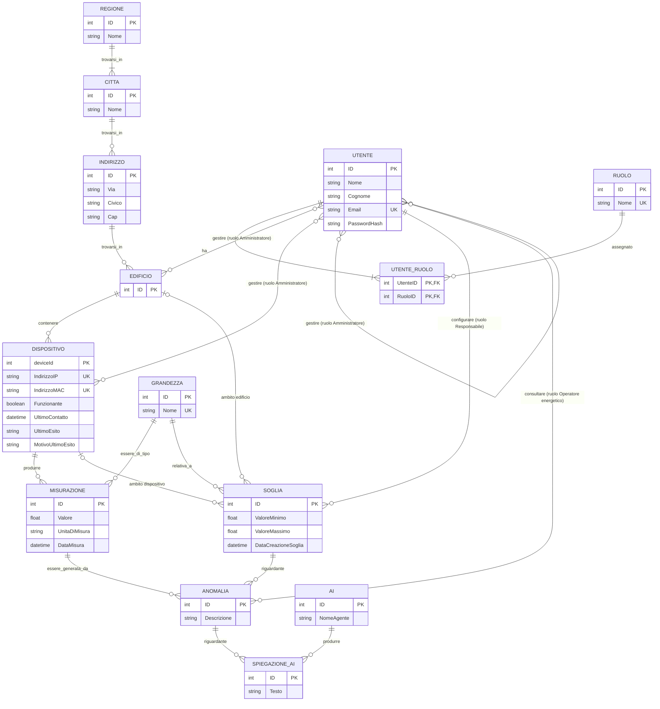

# Data Model: Descrizione ed analisi dello schema E/R e schema E/R

Questo schema E/R è stato creato con le informazioni contenute nei file: use-cases.md e requirements.md

Le identità degli utenti sono rappresentate da una sola entità **Utente**. Amministratore, Responsabile e Operatore energetico sono ruoli assegnati agli utenti, non entità distinte. La relazione tra Utente e Ruolo è molti-a-molti: una persona può ricoprire più ruoli e ciascun ruolo può essere assegnato a più utenti, in linea con gli attori descritti in [use-cases.md](./use-cases.md).

L'entità Utente conserva i dati anagrafici e l'indirizzo e-mail, oltre all'hash della password (`passwordHash`); non conserva la password in chiaro. In registrazione o salvataggio, Spring Security `PasswordEncoder` con BCrypt genera l'hash tramite `encode(...)`. Al login, `matches(...)` confronta la password inserita con l'hash persistito: la password non viene decifrata. Questo è il modello e il comportamento previsti; il backend non è ancora allineato e la documentazione non implica che autenticazione o persistenza BCrypt siano già implementate.

Il termine **dispositivo** identifica l'elemento anagrafico a cui sono associate le misure e, nel modello v1, l'edificio di appartenenza. Il dispositivo può essere alimentato da un generatore di dati simulati oppure, in futuro, da una sorgente reale. IP e MAC sono identificativi obbligatori e univoci del dispositivo (nel codice: `@NotBlank`/`@Pattern` su `CreateSimulator` e vincoli `NOT NULL`/`UNIQUE` su `sensor_simulators`); `deviceId` è l'identificativo applicativo usato nei payload proposti dall'architettura v1.

Il modello qui descritto è concettuale: l'implementazione API v0.1 è più limitata e usa ancora i nomi tecnici `simulatorId` e `/api/simulators`. La differenza è documentata in [API.md](./API.md); non modifica il vocabolario del modello v1.

---

## RELAZIONI:

- **Utente con ruolo Amministratore - Edificio/Dispositivo/Utente**: le operazioni di gestione sono associate all'Utente che le esegue e autorizzate in base al ruolo Amministratore. L'eventuale assegnazione esclusiva della gestione di una risorsa a un singolo amministratore resta *** DA CONFERMARE ***.
- **Dispositivo - Misurazione**: Il dispositivo può effettuare 0 misurazioni in momenti “particolari”, ad esempio all’avvio, quando non ha avuto il tempo di effettuare ancora nessuna misurazione.
- **Soglia - Grandezza e ambito**: ogni soglia è relativa a una sola grandezza e a un solo ambito, che può essere un edificio oppure un dispositivo. La cardinalità e il vincolo che rende esclusivi i due ambiti devono ancora essere confermati (vedi [domande-cliente.md](./domande-cliente.md)).
- **Utente con ruolo Responsabile - Soglia**: l'Utente che configura una soglia è identificato dall'audit; l'autorizzazione all'operazione dipende dal ruolo Responsabile. L'eventuale assegnazione esclusiva della gestione della soglia a un singolo responsabile resta *** DA CONFERMARE ***.
- **Anomalia - Misurazione**: si è ipotizzato che una specifica anomalia è relativa ad una singola misurazione, mentre una misurazione può causare più anomalie inteso come “può causare più anomalie nel corso del tempo”, quindi: un record nella tabella anomalie sarà referenziato solo ad un singolo record nel campo misurazioni, mentre un record nella tabella misurazioni può essere referenziato a più record nella tabella anomalie

---

## ENTITÀ :

- **Utente**: entità unica per tutte le persone che accedono al sistema. Comprende almeno ID, Nome, Cognome, Email univoca e `passwordHash`. La password in chiaro è usata solo nel flusso di autenticazione e non viene persistita.
- **Ruolo**: catalogo dei ruoli applicativi (Amministratore, Responsabile, Operatore energetico), separato dall'identità dell'utente. La relazione molti-a-molti Utente-Ruolo consente a una stessa persona di avere più ruoli.
- **Password e autenticazione**: salvare esclusivamente il risultato di `passwordEncoder.encode(password)` con un `PasswordEncoder` Spring Security configurato per BCrypt. Per il login usare `passwordEncoder.matches(passwordInserita, passwordHashSalvato)`; non è prevista né possibile una decifratura dell'hash. Implementazione demandata all'allineamento futuro del backend.
- **Grandezza**: si è ipotizzato che la grandezza (temperatura, potenza, tensione, ecc…) di una misurazione possa essere un’entità perché, al momento di una misurazione, la Soglia relativa al dispositivo che ha emesso quella misura oppure relativa ad uno specifico edificio punterà all'ID 1 (nella tabella Grandezza), e, allo stesso tempo, La Misurazione punterà anch’essa all'ID 1 (nella tabella Grandezza).
  Quando arriva quindi una misurazione, il database usa questo ID condiviso per fare un abbinamento matematico ed esatto tra la soglia impostata (sul singolo dispositivo o sull’intero edificio) e la misurazione appena ricevuta, sapendo con assoluta certezza che entrambe le tabelle stanno parlando dello stesso identico concetto.
- **Dispositivo**: gli attributi “indirizzo IP” ed “indirizzo MAC” sono stati inseriti per “soddisfare” il requisito che richiede che l’infrastruttura sia predisposta ad una futura implementazione con sensori reali; sono obbligatori e univoci. Lo stato della sorgente è descritto da tre attributi aggiornati a ogni invio di un dispositivo registrato: **UltimoContatto** (`lastContactAt`, data/ora dell'ultimo invio, accettato o rifiutato), **UltimoEsito** (`lastOutcome`, `ACCEPTED` o `REJECTED`) e **MotivoUltimoEsito** (`lastOutcomeReason`, motivo dell'ultimo rifiuto). L'attributo **Funzionante** (`functioning`) vale `true` alla registrazione e oggi non viene aggiornato dagli invii: non va usato per valutare lo stato della sorgente (vedi [API.md](./API.md#esiti-di-acquisizione-e-stato-delle-sorgenti)).
- **Misurazione**: **DataMisura** (`measuredAt`) è l'istante in cui la misura è stata rilevata, inviato dalla sorgente; se la sorgente non lo invia, il backend usa l'ora di ricezione. Non è quindi la data di inserimento del record nel database.
- **A.I**: questa entità è stata creata per tenere traccia di tutte le analisi/commenti/descrizioni che l’A.I che si è scelto di implementare nel sistema fornisce sulle anomalie generate, in modo da aiutare l’operatore energetico . Tuttavia non sono ancora chiari quali potrebbero essere degli attributi plausibili per queste entità. *** DA CONFERMARE ***
  Un’alternativa a questa soluzione potrebbe essere quella di inserire un campo dentro l’entità Anomalia che contiene la descrizione prodotta dall’AI ??? *** DA CONFERMARE ***
- **Dashboard**: La dashboard non è considerabile un’entità in quanto è solamente una parte dell’applicativo che si occuperà di mostrare i dati ricevuti dal backend, ma non è tracciabile come entità, in quanto non svolge nessuna funzione ma è solamente un insieme aggregato di dati già salvati in altre tabelle del DB.

---

## Use cases e requisiti che questa struttura soddisfa:

### 1. Verifiche e Mappatura dei Casi d'Uso (UC)

#### UC1 — Acquisire misure da più dispositivi

- Tabelle / Entità coinvolte: Dispositivo, Misurazione, Grandezza.
- Relazioni che lo soddisfano:
    - Dispositivo (0,N) ─── ─── (1,1) Misurazione (con attributo DataMisura)
    - Misurazione (1,1) ─── ─── (0,N) Grandezza
- Spiegazione: Registra il valore della misura, l'unità di misura, l'istante di rilevazione (DataMisura), la grandezza associata e il dispositivo sorgente. Gli attributi UltimoContatto, UltimoEsito e MotivoUltimoEsito sul dispositivo tracciano l'esito dell'ultimo invio della sorgente.

#### UC2 — Consultare misure recenti e storico

- Tabelle / Entità coinvolte: Utente (ruolo Operatore energetico), Edificio, Dispositivo, Grandezza, Misurazione.
- Relazioni che lo soddisfano:
    - Edificio (0,N) ─── ─── (1,1) Dispositivo
    - Dispositivo (0,N) ─── ─── (1,1) Misurazione
    - Misurazione (1,1) ─── ─── (0,N) Grandezza
- Spiegazione: Consente all'operatore di risalire dalle misurazioni temporali (DataMisura) allo specifico dispositivo, all'edificio di appartenenza e al tipo di grandezza.

#### UC3 — Consultare dashboard aggregata

- Tabelle / Entità coinvolte: Utente (ruolo Operatore energetico o Responsabile), Edificio, Dispositivo, Misurazione, Anomalia.
- Relazioni che lo soddisfano:
    - Edificio (0,N) ─── ─── (1,1) Dispositivo (0,N) ─── ─── (1,1) Misurazione
    - Misurazione (0,N) ─── ─── (1,1) Anomalia
    - Utente con ruolo Operatore energetico (0,N) ─── ─── (0,N) Anomalia
- Spiegazione: Fornisce la gerarchia completa per aggregare i dati recenti e visualizzare lo stato sintetico di un edificio, le relative misurazioni e le anomalie scattate.

#### UC4 — Configurare una soglia

- Tabelle / Entità coinvolte: Utente (ruolo Responsabile), Soglia, Grandezza, Dispositivo, Edificio.
- Relazioni che lo soddisfano:
    - Utente con ruolo Responsabile (0,N) ─── ─── (1,1) Soglia (con attributi AzioneEseguita, DataCreazioneSoglia, ValoreMassimo, ValoreMinimo)
    - Grandezza (0,N) ─── ─── (1,1) Soglia
    - Soglia (0,1) ─── ─── (0,N) Dispositivo, oppure Soglia (0,1) ─── ─── (0,N) Edificio; ogni soglia deve riferirsi a uno solo dei due ambiti, vincolo ancora da confermare.
- Spiegazione: Supporta la configurazione di min/max da parte del responsabile, con data e tracciamento delle modifiche, collegando la soglia alla grandezza e a un ambito (sensore singolo oppure edificio). La regola che impone un solo ambito deve ancora essere confermata.

#### UC5 — Generare e consultare un'anomalia

- Tabelle / Entità coinvolte: Misurazione, Soglia, Anomalia, Utente (ruolo Operatore energetico).
- Relazioni che lo soddisfano:
    - Misurazione (0,N) ─── ─── (1,1) Anomalia
    - Soglia (0,N) ─── ─── (1,1) Anomalia
    - Utente con ruolo Operatore energetico (0,N) ─── ─── (0,N) Anomalia
- Spiegazione: L'anomalia funge da entità punto di unione tra la misurazione che l'ha scatenata e la soglia violata, permettendo all'operatore di consultarne contesto e dettagli.

#### UC6 — Registrare la presa visione

- Tabelle / Entità coinvolte: Utente (ruolo Operatore energetico), Anomalia.
- Relazioni che lo soddisfano:
    - Utente con ruolo Operatore energetico (0,N) ─── ─── (0,N) Anomalia
- Spiegazione: Collega l'operatore all'anomalia consultata (con cardinalità N:M).

#### UC7 — Gestire edifici, dispositivi e utenti

- Tabelle / Entità coinvolte: Utente (ruolo Amministratore), Edificio, Dispositivo, Utente, Ruolo, Indirizzo, Città, Regione.
- Relazioni che lo soddisfano:
    - Utente con ruolo Amministratore (0,N) ─── ─── (0,N) Edificio (con TipologiaDiAzione; assegnazione esclusiva da confermare)
    - Utente con ruolo Amministratore (0,N) ─── ─── (0,N) Dispositivo (con TipologiaDiAzione; assegnazione esclusiva da confermare)
    - Utente con ruolo Amministratore (0,N) ─── ─── (0,N) Utente (con TipologiaDiAzione)
    - Utente (1,N) ─── ─── (0,N) Ruolo
    - Edificio (0,N) ─── ─── (1,1) Indirizzo (0,N) ─── ─── (1,1) Città (1,N) ─── ─── (1,1) Regione
- Spiegazione: Permette la creazione, aggiornamento e gestione dell'intera anagrafica di sistema e della collocazione geografica, tracciando le azioni amministrative.

#### UC8 — Verificare stato di sorgenti e componenti

- Tabelle / Entità coinvolte: Dispositivo, Utente (ruoli Amministratore e Responsabile).
- Relazioni e Attributi che lo soddisfano:
    - Attributi di Dispositivo: UltimoContatto, UltimoEsito, MotivoUltimoEsito (stato della sorgente), Indirizzo IP, Indirizzo MAC, ID.
- Spiegazione: Consente di verificare se lo specifico dispositivo/sorgente sta inviando dati validi e di identificarlo univocamente in rete. Lo stato della piattaforma (backend e database) è separato ed è esposto da `GET /actuator/health`.

#### UC9 — Ottenere una spiegazione AI (opzionale)

- Tabelle / Entità coinvolte: A.I., Descrizione/commento, Anomalia.
- Relazioni che lo soddisfano:
    - A.I. (0,N) ─── ─── (1,1) Descrizione/commento
    - Descrizione/commento (0,N) ─── ─── (1,1) Anomalia
- Spiegazione: L'agente AI genera una spiegazione testuale salvata separatamente e collegata all'anomalia, lasciando inalterati i dati originari di misura e soglia.

---

### 2. Verifiche e Mappatura dei Requisiti Funzionali (RF)

#### RF1 — Gestione e associazione di edifici e dispositivi

- Tabelle / Entità coinvolte: Utente (ruolo Amministratore), Edificio, Dispositivo, Grandezza.
- Soddisfatto da:
    - Utente con ruolo Amministratore (0,N) ─── ─── (0,N) Edificio
    - Utente con ruolo Amministratore (0,N) ─── ─── (0,N) Dispositivo
    - Edificio (0,N) ─── ─── (1,1) Dispositivo
    - Dispositivo (0,N) ─── ─── (1,1) Misurazione (1,1) ─── ─── (0,N) Grandezza

#### RF2 — Acquisizione e registrazione misure simulate

- Tabelle / Entità coinvolte: Dispositivo, Misurazione, Grandezza.
- Soddisfatto da:
    - Dispositivo (0,N) ─── ─── (1,1) Misurazione (Valore, Unità di misura, DataMisura) (1,1) ─── ─── (0,N) Grandezza (Nome).

#### RF3 — Validazione misure e gestione errori sorgente

- Tabelle / Entità coinvolte: Dispositivo, Misurazione.
- Soddisfatto da:
    - Gli attributi UltimoEsito e MotivoUltimoEsito e i dati di rete (Indirizzo IP/MAC) su Dispositivo consentono al sistema di associare l'esito di validazione o l'errore alla specifica sorgente.

#### RF4 — Consultazione ultimo valore e storico con filtri

- Tabelle / Entità coinvolte: Utente (ruolo Operatore energetico), Edificio, Dispositivo, Grandezza, Misurazione.
- Soddisfatto da:
    - Edificio (0,N) ─── ─── (1,1) Dispositivo (0,N) ─── ─── (1,1) Misurazione (1,1) ─── ─── (0,N) Grandezza.

#### RF5 — Creazione e modifica soglie per grandezza e ambito

- Tabelle / Entità coinvolte: Utente (ruolo Responsabile), Soglia, Grandezza, Edificio, Dispositivo.
- Soddisfatto da:
    - Utente con ruolo Responsabile (0,N) ─── ─── (1,1) Soglia
    - Grandezza (0,N) ─── ─── (1,1) Soglia
    - Soglia (0,1) ─── ─── (0,N) Dispositivo oppure Edificio; ogni soglia deve riferirsi a un solo ambito, vincolo ancora da confermare.

#### RF6 — Generazione anomalia da superamento soglia

- Tabelle / Entità coinvolte: Misurazione, Soglia, Anomalia.
- Soddisfatto da:
    - Misurazione (0,N) ─── ─── (1,1) Anomalia (1,1) ─── ─── (0,N) Soglia.

#### RF7 — Consultazione anomalie e presa visione senza alterare la misura

- Tabelle / Entità coinvolte: Utente (ruolo Operatore energetico), Anomalia, Misurazione.
- Soddisfatto da:
    - Utente con ruolo Operatore energetico (0,N) ─── ─── (0,N) Anomalia; ogni anomalia è collegata a una misurazione e una misurazione può generare zero o più anomalie.

#### RF8 — Dashboard con sintesi per edificio/gruppo e anomalie

- Tabelle / Entità coinvolte: Edificio, Dispositivo, Misurazione, Anomalia.
- Soddisfatto da:
    - Edificio (0,N) ─── ─── (1,1) Dispositivo (0,N) ─── ─── (1,1) Misurazione (0,N) ─── ─── (1,1) Anomalia.

#### RF9 — Accesso dati tramite interfacce definite (Dispositivo vs Dashboard)

- Soddisfatto da:
    - Disaccoppiamento architetturale: il dispositivo scrive su Misurazione tramite Dispositivo (0,N) ── ── (1,1), mentre la Dashboard legge aggregando da Edificio, Misurazione e Anomalia.

#### RF10 — Registrazione esiti e stato sorgenti / ultimo contatto

- Tabelle / Entità coinvolte: Dispositivo.
- Soddisfatto da:
    - Attributi UltimoContatto, UltimoEsito e MotivoUltimoEsito ed identificativi di rete (Indirizzo IP, Indirizzo MAC) sul dispositivo.

#### RF11 — Distinzione permessi e ruoli utente

- Tabelle / Entità coinvolte: Utente, Ruolo, associazione Utente-Ruolo.
- Soddisfatto da:
    - Un'unica entità Utente associata a uno o più ruoli; i permessi determinano le operazioni consentite (<Gestire>, <Configurare>, <Consultare>).

#### RF12 — Tracciabilità modifiche a configurazioni e soglie

- Tabelle / Entità coinvolte: Utente (ruoli Amministratore e Responsabile), Soglia, Edificio, Dispositivo.
- Soddisfatto da:
    - Attributo TipologiaDiAzione sulle relazioni <Gestire> (0,N) ── (0,N).
    - Attributi AzioneEseguita sulla relazione <Configurare> (0,N) ── (1,1) e DataCreazioneSoglia in Soglia.

#### RF13 — Generazione spiegazione AI non vincolante

- Tabelle / Entità coinvolte: A.I., Descrizione/commento, Anomalia.
- Soddisfatto da:
    - A.I. (0,N) ─── ─── (1,1) Descrizione/commento (0,N) ─── ─── (1,1) Anomalia.

---

## Corrispondenza con le tabelle implementate (v0.1)

Il backend v0.1 implementa solo Dispositivo, Grandezza e Misurazione; le
tabelle sono generate da Hibernate a partire dalle entità JPA in
`backend/src/main/java/it/energymonitor/backend/persistence/entity/`.

| Entità logica | Tabella             | Entità JPA              | Colonne (attributo logico → colonna)                                                                                                                                                                                                                                              |
| ------------- | ------------------- | ----------------------- | --------------------------------------------------------------------------------------------------------------------------------------------------------------------------------------------------------------------------------------------------------------------------------- |
| Dispositivo   | `sensor_simulators` | `SensorSimulatorEntity` | deviceId → `id`; IndirizzoIP → `ip_address` (NOT NULL, UNIQUE); IndirizzoMAC → `mac_address` (NOT NULL, UNIQUE); Funzionante → `functioning`; UltimoContatto → `last_contact_at`; UltimoEsito → `last_outcome` (`ACCEPTED`/`REJECTED`); MotivoUltimoEsito → `last_outcome_reason` |
| Grandezza     | `quantities`        | `QuantityEntity`        | ID → `id`; Nome → `name` (NOT NULL, UNIQUE, max 100 caratteri)                                                                                                                                                                                                                    |
| Misurazione   | `measurements`      | `MeasurementEntity`     | ID → `id`; dispositivo → `simulator_id` (FK); grandezza → `quantity_id` (FK); Valore → `measurement_value`; UnitaDiMisura → `unit` (max 32 caratteri); DataMisura → `measured_at`                                                                                                 |

Le altre entità (Utente, Ruolo, Edificio, Soglia, Anomalia, A.I., ecc.) non
hanno ancora una tabella nel backend.

---

## Diagramma Entity-Relationship (Mermaid)

Per le soglie il diagramma mostra i due ambiti possibili, edificio o
dispositivo; il vincolo che ne impone uno solo non è esprimibile qui ed è
ancora da confermare.

