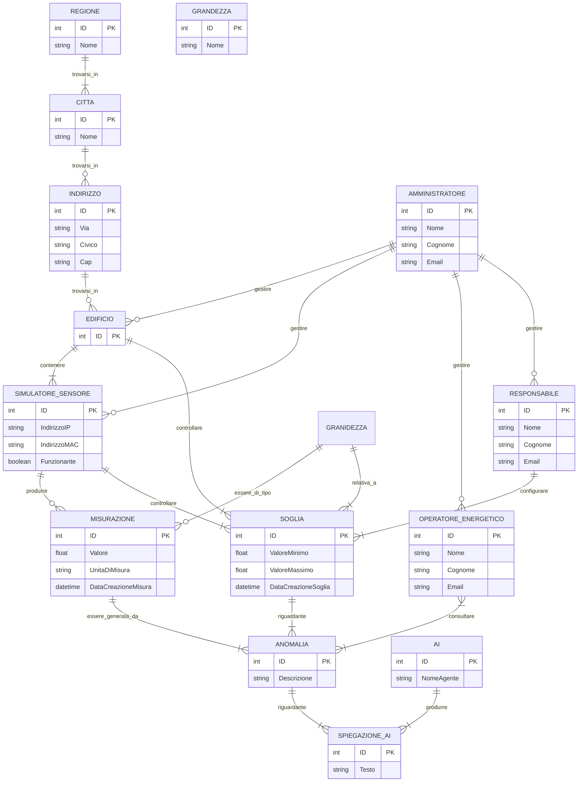

# Data Model: Descrizione ed analisi dello schema E/R e schema E/R

Questo schema E/R è stato creato con le informazioni contenute nei file: use-cases.md e requirements.md

Originariamente, le 3 entità che identificano gli utenti, ovvero Amministratore, Operatore energetico e Responsabile erano figlie dell’entità Utente; per ristrutturare lo schema si è deciso di “collassare verso il basso” l’entità padre Utente.

Momentaneamente non esistono sensori o sistemi di misurazione reali, ecco perché l’entità che si occupa di effettuare le misurazioni è denominata “Simulatore di sensore”. Tuttavia, questa infrastruttura è già predisposta per uno scenario in cui vengano utilizzati sensori reali.

---

## RELAZIONI:

- **Amministratore - Edificio**: si è ipotizzato che un amministratore gestisca più edifici ma che un edificio sia gestito da 1 solo amministratore. (con questa soluzione, l’edificio gestito da Amministratore 1 non potrebbe essere gestito da Amministratore 2 in caso di necessità, ad esempio: amministratore 1 non è presente sul luogo di lavoro e l’edificio “x” dev’essere modificato… ) *** DA CONFERMARE ***
- **Amministratore - Simulatore**: vedi Amministratore - Edificio (stessa “problematica”)
- **Amministratore - Utente**: vedi Amministratore - Edificio (stessa “problematica”)
- **Simulatore di sensore - Misurazione**: Il simulatore può effettuare 0 misurazioni in momenti “particolari”, ad esempio all’avvio, quando non ha avuto il tempo di effettuare ancora nessuna misurazione.
- **Misurazione - Soglia**: Si è ipotizzato che una soglia sia relativa solo ad 1 singola “tipologia” di misurazione (ovvero solo alle misurazioni prodotte dal singolo simulatore)
- **Responsabile - Soglia**: si è ipotizzato che un responsabile gestisca più soglie ma che una soglia sia gestita da 1 solo responsabile. (con questa soluzione, la soglia gestita da responsabile 1 non potrebbe essere gestita da responsabile 2 in caso di necessità, ad esempio: responsabile 1 non è presente sul luogo di lavoro e la soglia “x” dev’essere modificata…) *** DA CONFERMARE ***
- **Anomalia - Misurazione**: si è ipotizzato che una specifica anomalia è relativa ad una singola misurazione, mentre una misurazione può causare più anomalie inteso come “può causare più anomalie nel corso del tempo”, quindi: un record nella tabella anomalie sarà referenziato solo ad un singolo record nel campo misurazioni, mentre un record nella tabella misurazioni può essere referenziato a più record nella tabella anomalie

---

## ENTITÀ :

- **Grandezza**: si è ipotizzato che la grandezza (temperatura, potenza, tensione, ecc…) di una misurazione possa essere un’entità perché, al momento di una misurazione, la Soglia relativa al simulatore che ha emesso quella misura oppure relativa ad uno specifico edificio punterà all'ID 1 (nella tabella Grandezza), e, allo stesso tempo, La Misurazione punterà anch’essa all'ID 1 (nella tabella Grandezza).
  Quando arriva quindi una misurazione, il database usa questo ID condiviso per fare un abbinamento matematico ed esatto tra la soglia impostata (sul singolo simulatore o sull’intero edificio) e la misurazione appena ricevuta, sapendo con assoluta certezza che entrambe le tabelle stanno parlando dello stesso identico concetto.
- **Simulatore di sensore**: gli attributi “indirizzo IP” ed “indirizzo MAC” sono stati inseriti per “soddisfare” il requisito che richiede che l’infrastruttura sia predisposta ad una futura implementazione con sensori reali.
- **A.I**: questa entità è stata creata per tenere traccia di tutte le analisi/commenti/descrizioni che l’A.I che si è scelto di implementare nel sistema fornisce sulle anomalie generate, in modo da aiutare l’operatore energetico . Tuttavia non sono ancora chiari quali potrebbero essere degli attributi plausibili per queste entità. *** DA CONFERMARE ***
  Un’alternativa a questa soluzione potrebbe essere quella di inserire un campo dentro l’entità Anomalia che contiene la descrizione prodotta dall’AI ??? *** DA CONFERMARE ***
- **Dashboard**: La dashboard non è considerabile un’entità in quanto è solamente una parte dell’applicativo che si occuperà di mostrare i dati ricevuti dal backend, ma non è tracciabile come entità, in quanto non svolge nessuna funzione ma è solamente un insieme aggregato di dati già salvati in altre tabelle del DB.

---

## Use cases e requisiti che questa struttura soddisfa:

### 1. Verifiche e Mappatura dei Casi d'Uso (UC)

#### UC1 — Acquisire misure da più dispositivi

- Tabelle / Entità coinvolte: Simulatore di sensore, Misurazione, Grandezza.
- Relazioni che lo soddisfano:
  - Simulatore di sensore (0,N) ─── ─── (1,1) Misurazione (con attributo DataCreazioneMisura)
  - Misurazione (1,1) ─── ─── (0,N) Grandezza
- Spiegazione: Registra il valore della misura, l'unità di misura, il timestamp di creazione, la grandezza associata e il sensore/simulatore sorgente. L'attributo Funzionante sul simulatore traccia la salute della sorgente interessata.

#### UC2 — Consultare misure recenti e storico

- Tabelle / Entità coinvolte: Operatore energetico, Edificio, Simulatore di sensore, Grandezza, Misurazione.
- Relazioni che lo soddisfano:
  - Edificio (1,N) ─── ─── (1,1) Simulatore di sensore
  - Simulatore di sensore (0,N) ─── ─── (1,1) Misurazione
  - Misurazione (1,1) ─── ─── (0,N) Grandezza
- Spiegazione: Consente all'operatore di risalire dalle misurazioni temporali (DataCreazioneMisura) allo specifico dispositivo, all'edificio di appartenenza e al tipo di grandezza.

#### UC3 — Consultare dashboard aggregata

- Tabelle / Entità coinvolte: Operatore energetico, Responsabile, Edificio, Simulatore di sensore, Misurazione, Anomalia.
- Relazioni che lo soddisfano:
  - Edificio (1,N) ─── ─── (1,1) Simulatore di sensore (0,N) ─── ─── (1,1) Misurazione
  - Misurazione (1,N) ─── ─── (1,1) Anomalia
  - Operatore energetico (1,N) ─── ─── (1,N) Anomalia
- Spiegazione: Fornisce la gerarchia completa per aggregare i dati recenti e visualizzare lo stato sintetico di un edificio, le relative misurazioni e le anomalie scattate.

#### UC4 — Configurare una soglia

- Tabelle / Entità coinvolte: Responsabile, Soglia, Grandezza, Simulatore di sensore, Edificio.
- Relazioni che lo soddisfano:
  - Responsabile (1,N) ─── ─── (1,1) Soglia (con attributi AzioneEseguita, DataCreazioneSoglia, ValoreMassimo, ValoreMinimo)
  - Grandezza (1,N) ─── ─── (1,1) Soglia
  - Soglia (1,N) ─── ─── (1,1) Simulatore di sensore
  - Soglia (1,N) ─── ─── (1,1) Edificio
- Spiegazione: Supporta la configurazione di min/max da parte del responsabile, con data e tracciamento delle modifiche, collegando la soglia sia alla grandezza sia al doppio ambito (sensore singolo oppure edificio).

#### UC5 — Generare e consultare un'anomalia

- Tabelle / Entità coinvolte: Misurazione, Soglia, Anomalia, Operatore energetico.
- Relazioni che lo soddisfano:
  - Misurazione (1,N) ─── ─── (1,1) Anomalia
  - Anomalia (1,1) ─── ─── (1,N) Soglia
  - Operatore energetico (1,N) ─── ─── (1,N) Anomalia
- Spiegazione: L'anomalia funge da entità punto di unione tra la misurazione che l'ha scatenata e la soglia violata, permettendo all'operatore di consultarne contesto e dettagli.

#### UC6 — Registrare la presa visione

- Tabelle / Entità coinvolte: Operatore energetico, Anomalia.
- Relazioni che lo soddisfano:
  - Operatore energetico (1,N) ─── ─── (1,N) Anomalia
- Spiegazione: Collega l'operatore all'anomalia consultata (con cardinalità N:M).

#### UC7 — Gestire edifici, dispositivi e utenti

- Tabelle / Entità coinvolte: Amministratore, Edificio, Simulatore di sensore, Operatore energetico, Responsabile, Indirizzo, Città, Regione.
- Relazioni che lo soddisfano:
  - Amministratore (0,N) ─── ─── (1,1) Edificio (con TipologiaDiAzione)
  - Amministratore (0,N) ─── ─── (1,1) Simulatore di sensore (con TipologiaDiAzione)
  - Amministratore (0,N) ─── ─── (1,1) Operatore energetico (con TipologiaDiAzione)
  - Amministratore (0,N) ─── ─── (1,1) Responsabile (con TipologiaDiAzione)
  - Edificio (1,1) ─── ─── (0,N) Indirizzo (1,1) ─── ─── (0,N) Città (1,1) ─── ─── (1,N) Regione
- Spiegazione: Permette la creazione, aggiornamento e gestione dell'intera anagrafica di sistema e della collocazione geografica, tracciando le azioni amministrative.

#### UC8 — Verificare stato di sorgenti e componenti

- Tabelle / Entità coinvolte: Simulatore di sensore, Amministratore, Responsabile.
- Relazioni e Attributi che lo soddisfano:
  - Attributi di Simulatore di sensore: Funzionante (stato di salute), Indirizzo IP, Indirizzo MAC, ID.
- Spiegazione: Consente di verificare se lo specifico simulatore/sorgente è operativo e di identificarlo univocamente in rete.

#### UC9 — Ottenere una spiegazione AI (opzionale)

- Tabelle / Entità coinvolte: A.I., Descrizione/commento, Anomalia.
- Relazioni che lo soddisfano:
  - A.I. (1,N) ─── ─── (1,1) Descrizione/commento
  - Descrizione/commento (1,1) ─── ─── (1,N) Anomalia
- Spiegazione: L'agente AI genera una spiegazione testuale salvata separatamente e collegata all'anomalia, lasciando inalterati i dati originari di misura e soglia.

---

### 2. Verifiche e Mappatura dei Requisiti Funzionali (RF)

#### RF1 — Gestione e associazione di edifici e dispositivi

- Tabelle / Entità coinvolte: Amministratore, Edificio, Simulatore di sensore, Grandezza.
- Soddisfatto da:
  - Amministratore (0,N) ─── ─── (1,1) Edificio
  - Amministratore (0,N) ─── ─── (1,1) Simulatore di sensore
  - Edificio (1,N) ─── ─── (1,1) Simulatore di sensore
  - Simulatore di sensore (0,N) ─── ─── (1,1) Misurazione (1,1) ─── ─── (0,N) Grandezza

#### RF2 — Acquisizione e registrazione misure simulate

- Tabelle / Entità coinvolte: Simulatore di sensore, Misurazione, Grandezza.
- Soddisfatto da:
  - Simulatore di sensore (0,N) ─── ─── (1,1) Misurazione (Valore, Unità di misura, DataCreazioneMisura) (1,1) ─── ─── (0,N) Grandezza (Nome).

#### RF3 — Validazione misure e gestione errori sorgente

- Tabelle / Entità coinvolte: Simulatore di sensore, Misurazione.
- Soddisfatto da:
  - L'attributo Funzionante e i dati di rete (Indirizzo IP/MAC) su Simulatore di sensore consentono al sistema di associare l'esito di validazione o l'errore alla specifica sorgente.

#### RF4 — Consultazione ultimo valore e storico con filtri

- Tabelle / Entità coinvolte: Operatore energetico, Edificio, Simulatore di sensore, Grandezza, Misurazione.
- Soddisfatto da:
  - Edificio (1,N) ─── ─── (1,1) Simulatore di sensore (0,N) ─── ─── (1,1) Misurazione (1,1) ─── ─── (0,N) Grandezza.

#### RF5 — Creazione e modifica soglie per grandezza e ambito

- Tabelle / Entità coinvolte: Responsabile, Soglia, Grandezza, Edificio, Simulatore di sensore.
- Soddisfatto da:
  - Responsabile (1,N) ─── ─── (1,1) Soglia
  - Grandezza (1,N) ─── ─── (1,1) Soglia
  - Soglia (1,N) ─── ─── (1,1) Simulatore di sensore
  - Soglia (1,N) ─── ─── (1,1) Edificio

#### RF6 — Generazione anomalia da superamento soglia

- Tabelle / Entità coinvolte: Misurazione, Soglia, Anomalia.
- Soddisfatto da:
  - Misurazione (1,N) ─── ─── (1,1) Anomalia (1,1) ─── ─── (1,N) Soglia.

#### RF7 — Consultazione anomalie e presa visione senza alterare la misura

- Tabelle / Entità coinvolte: Operatore energetico, Anomalia, Misurazione.
- Soddisfatto da:
  - Operatore energetico (1,N) ─── ─── (1,N) Anomalia (1,1) ─── ─── (1,N) Misurazione.

#### RF8 — Dashboard con sintesi per edificio/gruppo e anomalie

- Tabelle / Entità coinvolte: Edificio, Simulatore di sensore, Misurazione, Anomalia.
- Soddisfatto da:
  - Edificio (1,N) ─── ─── (1,1) Simulatore di sensore (0,N) ─── ─── (1,1) Misurazione (1,N) ─── ─── (1,1) Anomalia.

#### RF9 — Accesso dati tramite interfacce definite (Simulatore vs Dashboard)

- Soddisfatto da:
  - Disaccoppiamento architetturale: il simulatore scrive su Misurazione tramite Simulatore di sensore (0,N) ── ── (1,1), mentre la Dashboard legge aggregando da Edificio, Misurazione e Anomalia.

#### RF10 — Registrazione esiti e stato sorgenti / ultimo contatto

- Tabelle / Entità coinvolte: Simulatore di sensore.
- Soddisfatto da:
  - Attributo Funzionante ed identificativi di rete (Indirizzo IP, Indirizzo MAC) sul simulatore.

#### RF11 — Distinzione permessi e ruoli utente

- Tabelle / Entità coinvolte: Amministratore, Responsabile, Operatore energetico.
- Soddisfatto da:
  - Entità separate nello schema con privilegi e relazioni distinte (<Gestire>, <Configurare>, <Consultare>).

#### RF12 — Tracciabilità modifiche a configurazioni e soglie

- Tabelle / Entità coinvolte: Amministratore, Responsabile, Soglia, Edificio, Simulatore di sensore.
- Soddisfatto da:
  - Attributo TipologiaDiAzione sulle relazioni <Gestire> (0,N) ── (1,1).
  - Attributi AzioneEseguita sulla relazione <Configurare> (1,N) ── (1,1) e DataCreazioneSoglia in Soglia.

#### RF13 — Generazione spiegazione AI non vincolante

- Tabelle / Entità coinvolte: A.I., Descrizione/commento, Anomalia.
- Soddisfatto da:
  - A.I. (1,N) ─── ─── (1,1) Descrizione/commento (1,1) ─── ─── (1,N) Anomalia.

---

## Diagramma Entity-Relationship (Mermaid)

